# Zocial: a small social platform

Zocial is a full-stack social app for a small community. Members have profiles, write posts with an optional photo, react with one of five emoji, and talk in the comments. The server makes sure nobody can edit or delete someone else's content, and every list handles loading, empty and error states.

- **Live demo:** [ADD: your Render URL, e.g. https://zocial.onrender.com]
- **Demo video:** [ADD: YouTube or LinkedIn link]

On the live demo, pick one of the **Try a demo account** members on the sign-in page. Sign in as two different members (one in a private window) to see the ownership rules in action.

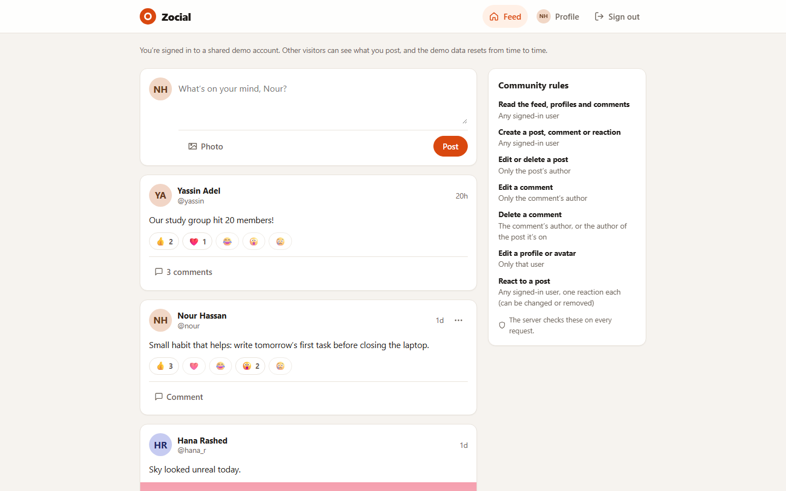

Built for the UneeQ Interns Web Development track, task "Social Platform Mini Product".

## Task requirements and where they are met

| Requirement | How Zocial does it |
| --- | --- |
| Profiles and posts | Sign-up with a username, a profile page per member (photo, name, bio, post count, reactions received, join date), and posts with up to 1000 characters and an optional photo. Authors can edit and delete their posts. |
| Comments and reactions | Comments under every post, with edit and delete. Five reactions (👍 ❤️ 😂 😮 😢), one per person per post, which can be changed or removed. Reaction counts update instantly and roll back if the server refuses. |
| Image upload or placeholder media | Photo upload for posts and avatars. The browser resizes photos and strips their metadata before upload, and the server checks the real file type from its bytes. Members without a photo get an initials avatar, and the seed data includes generated landscape pictures. |
| Pagination | Cursor pagination for the feed, profiles and comments. The next page of posts loads as you scroll, with a "Load more" button as a fallback. New posts never cause duplicates on the next page. |
| Basic authorization rules | Only a post's author can edit or delete it. Only a comment's author can edit it, and the author or the owner of the post can delete it. Profiles can only be changed through `/api/me`. |

| Success criterion | Evidence |
| --- | --- |
| Users cannot edit or delete others' content | Enforced in the API by [`shared/rules.ts`](shared/rules.ts). Tests sign in as two people and check that the other one gets `403` on edit and delete. The UI only shows the post menu and the comment Edit and Delete links where they will work. |
| UI handles empty, loading and error states | Skeleton posts while loading. Empty feed, empty profile and "no comments yet" messages. Error cards with a Try again button, "this profile doesn't exist", "this post isn't available", a toast when a reaction fails, and a sign-in prompt when the session ends. |
| Repository is organized | `server/` (API), `shared/` (rules, validation, types used by both sides), `src/` (React app), `tests/`, `docs/`. See [Project structure](#project-structure). |
| Database/schema notes | [docs/database.md](docs/database.md): ER diagram, every table and column, delete rules, indexes and the pagination queries. |

## Screenshots

| Comments on a post | Your own post: edit and delete |
| --- | --- |
| 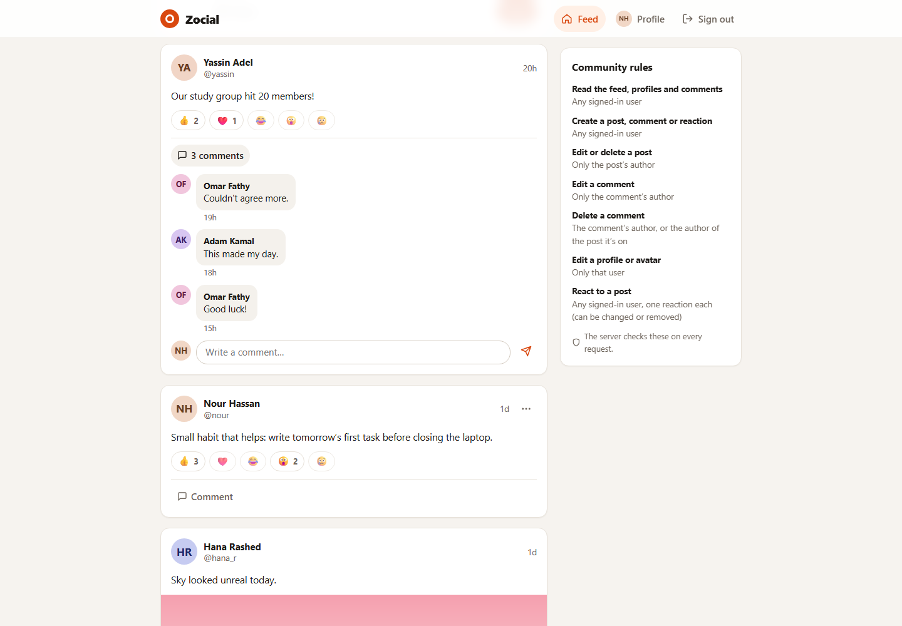 | 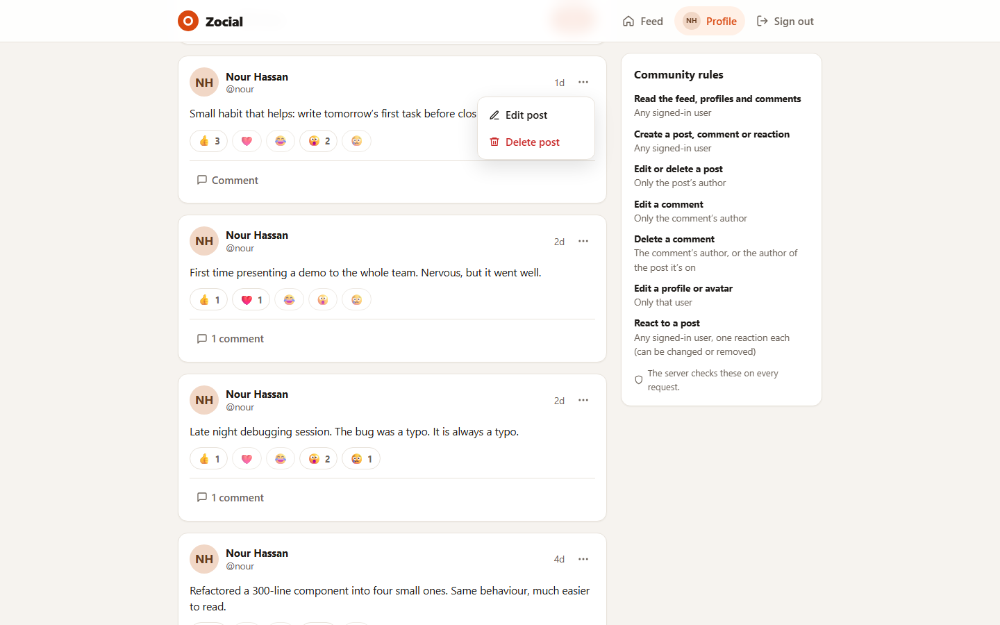 |

| Photo upload with preview | Validation |
| --- | --- |
| 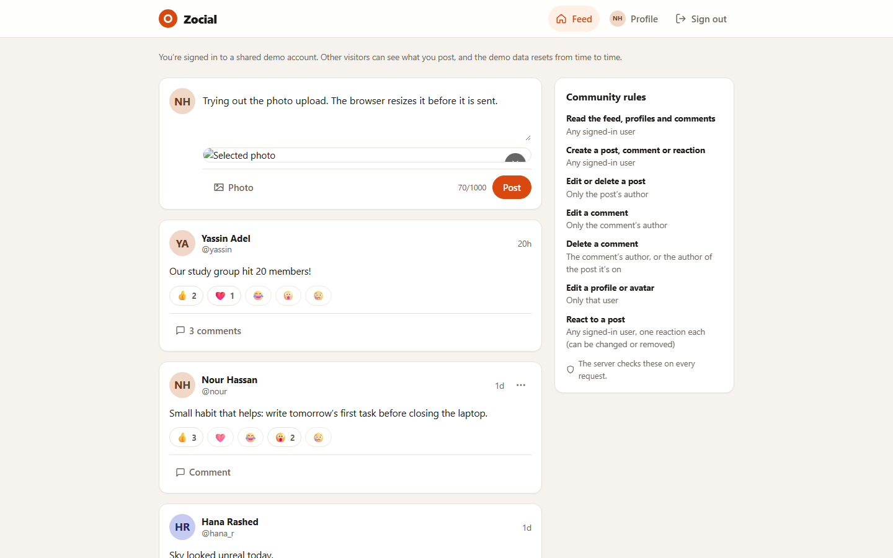 | 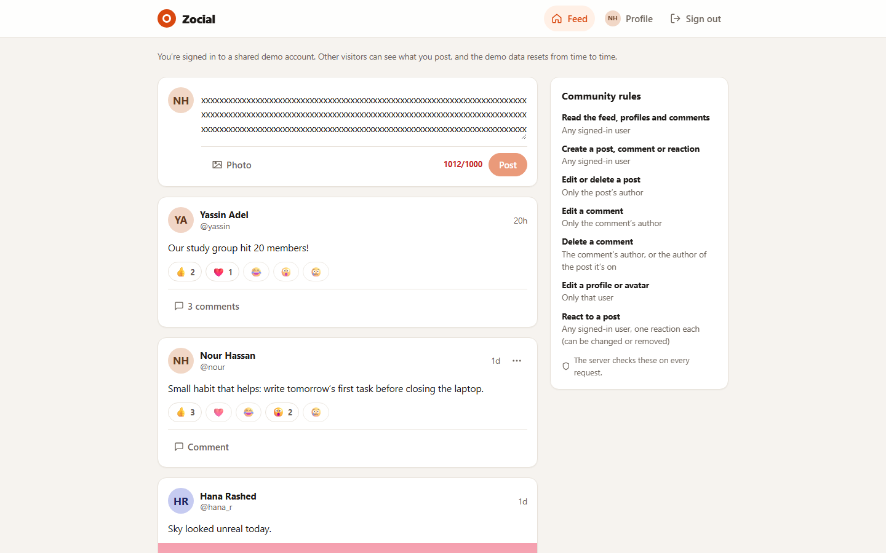 |

| A profile | Editing your profile |
| --- | --- |
| 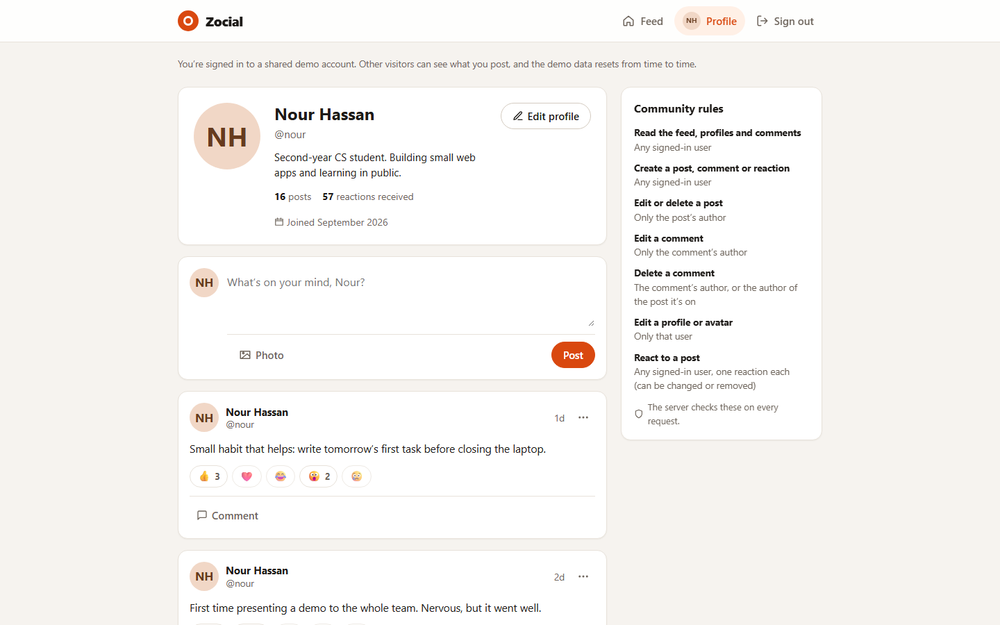 | 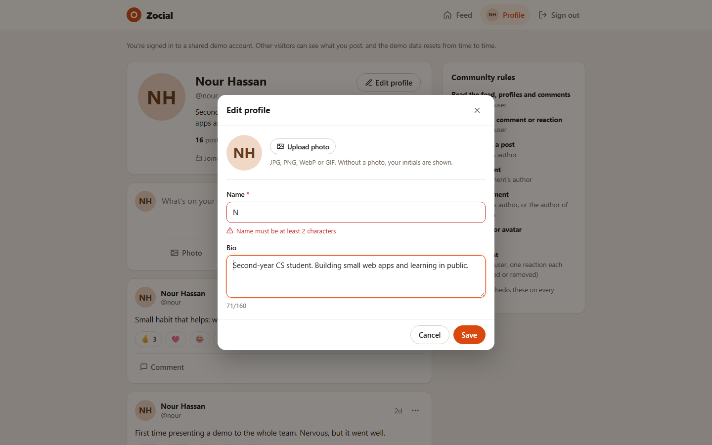 |

| Someone else's profile (no edit controls) | Profile that doesn't exist |
| --- | --- |
| 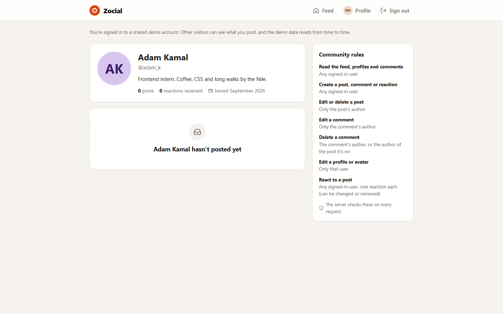 | 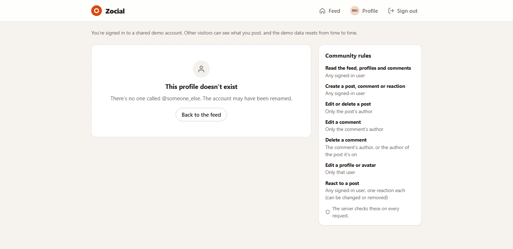 |

### On a phone

| Feed | Profile |
| --- | --- |
| 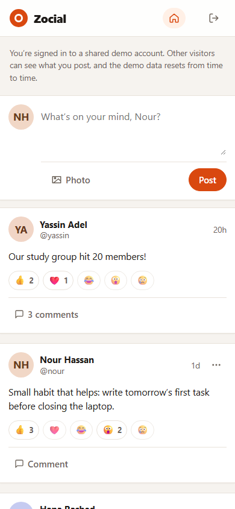 | 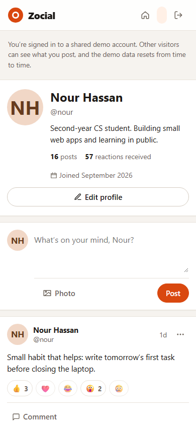 |

The app also follows the system dark mode.

## Getting started

You need Node.js 22.13 or newer (24 recommended). There is no database server to install: Zocial uses the SQLite engine built into Node.

```bash
git clone https://github.com/YOUR-USERNAME/zocial-social-platform.git
cd zocial-social-platform
npm install
npm run dev
```

Open http://localhost:5175. The first start creates `data/zocial.db` with eight demo members, 38 posts, comments and reactions. Pick a demo member on the sign-in page, or create your own account.

To run the production build locally:

```bash
npm run build
npm start
```

Then open http://localhost:3002.

| Command | What it does |
| --- | --- |
| `npm run dev` | Start the API (port 3002) and the Vite dev server (port 5175) together |
| `npm test` | Run the 18 API tests (Vitest + Supertest) |
| `npm run build` | Type-check everything and build the client into `dist/` |
| `npm start` | Start the server, which also serves `dist/` |
| `npm run seed` | Wipe the local database and load the demo data again |

### Settings

All optional. Copy `.env.example` to `.env` to change them. None of them is a secret.

| Variable | Default | Meaning |
| --- | --- | --- |
| `PORT` | `3002` | Port in production. Render sets it for you. |
| `API_PORT` | `3002` | Port the API uses during `npm run dev` |
| `DATA_DIR` | `./data` | Folder for the SQLite file (images are stored inside it) |
| `DEMO_LOGIN` | `true` | Show the demo members on the sign-in page |
| `DEMO_RESET_HOURS` | `0` | Wipe and re-seed every N hours. The Render blueprint uses 6. |

## Deploying

### Render (free)

1. Push this repository to GitHub.
2. On [Render](https://render.com), choose **New → Blueprint** and select the repository. Render reads `render.yaml`.
3. Wait for the first build (about three minutes). The URL appears at the top of the service page.

The free plan sleeps after 15 minutes without traffic, so the first visit after a pause takes up to a minute. Its disk is also temporary, so posts and uploads go back to the demo data on every restart or redeploy. That suits a public demo. For real use, attach a persistent disk and point `DATA_DIR` at it.

### Docker

```bash
docker build -t zocial .
docker run -p 3000:3000 -v zocial-data:/data zocial
```

## How it works

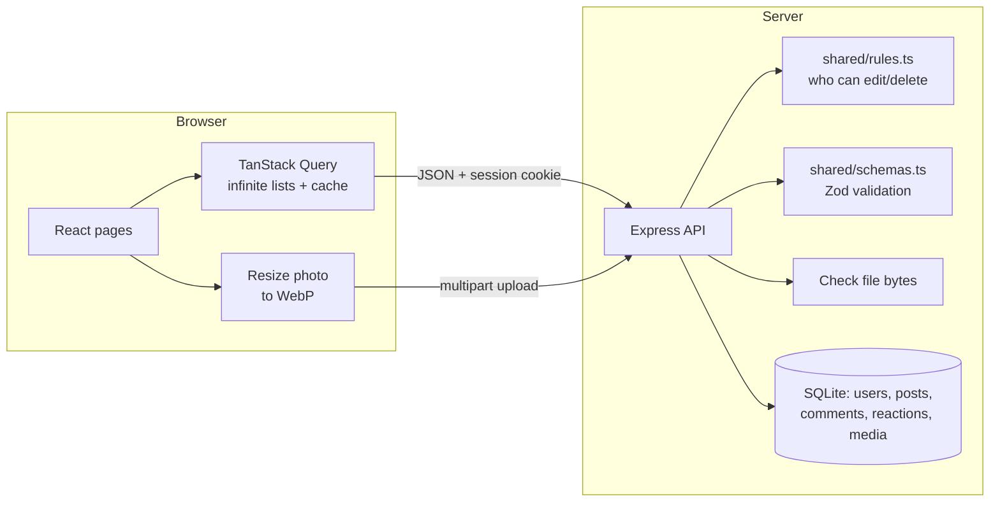

- **Client:** React 19, React Router 7 and TanStack Query, built with Vite. A post can appear in several lists at once (the feed, a profile, its own page). Edits, deletes and reactions update every cached copy, so the screens stay in sync without refetching.
- **Server:** Express 5, `node:sqlite`, Multer for uploads. Every query uses bound parameters.
- **Shared:** `shared/` holds the authorization rules, the validation rules and the response types. The browser uses the same rules to decide what to show, and the server uses them to decide what to allow.

The data model, delete rules, indexes and the reasoning behind cursor pagination are in [docs/database.md](docs/database.md).

### API

All routes are under `/api`. Every request that changes something must send the header `X-Requested-With: zocial`.

| Method and path | Who | Purpose |
| --- | --- | --- |
| `POST /auth/register`, `POST /auth/login`, `POST /auth/logout` | anyone | Accounts and sessions |
| `POST /auth/demo` | anyone, if `DEMO_LOGIN=true` | Sign in as a demo member |
| `GET /auth/me` | signed in | The current user |
| `PATCH /me` | signed in | Change your name and bio |
| `PUT /me/avatar`, `DELETE /me/avatar` | signed in | Upload or remove your photo (multipart field `image`) |
| `GET /users/:username` | signed in | A profile with counts |
| `GET /posts?cursor=&limit=&author=` | signed in | Feed or one member's posts, newest first |
| `POST /posts` | signed in | New post (multipart: `body`, optional `image`) |
| `GET /posts/:id` | signed in | One post |
| `PATCH /posts/:id`, `DELETE /posts/:id` | the author | Edit text or remove the photo, or delete |
| `PUT /posts/:id/reaction`, `DELETE /posts/:id/reaction` | signed in | Set, change or remove your reaction |
| `GET /posts/:id/comments?cursor=&limit=` | signed in | Comments, oldest first |
| `POST /posts/:id/comments` | signed in | New comment |
| `PATCH /comments/:id` | the comment's author | Edit |
| `DELETE /comments/:id` | the comment's author or the post's author | Delete |
| `GET /media/:id` | anyone with the link | An uploaded image |

Lists return `{ "items": [...], "nextCursor": "..." }`. `nextCursor` is `null` on the last page. Errors look like `{ "error": { "message": "...", "fieldErrors": { "body": "..." } } }`.

### Project structure

```
server/
  index.ts                start-up: open the database, seed, listen
  app.ts                  Express app (also used by the tests)
  auth.ts                 password hashing, sessions, CSRF header check, sign-in limiter
  db.ts                   schema, transactions, cursor encoding
  media.ts                upload limits, file-type check, image serving
  views.ts                queries that build post and comment responses
  routes/auth.ts          accounts, your profile, public profiles
  routes/posts.ts         posts, reactions, comments
  seed.ts                 demo community
  placeholder-images.ts   draws the seed pictures as PNG
shared/
  rules.ts                who may edit or delete what
  schemas.ts              Zod validation rules and limits
  types.ts                API response types
src/
  pages/                  feed, profile, single post, sign-in pages
  components/             PostCard, Comments, Composer, PostList, Layout, UI kit
  posts-cache.ts          keeps every cached copy of a post in sync
  images.ts               resizes photos in the browser before upload
tests/                    API tests
docs/                     database notes, screenshots
```

## Security

- Passwords are hashed with scrypt and a random salt. Demo accounts have no password at all.
- Sessions use a random token in an HttpOnly, SameSite=Lax cookie (Secure in production). Only a hash of the token is stored.
- Writes need a custom request header, which blocks cross-site form posts.
- Uploads: one file, 3 MB at most, and the type is read from the file's bytes. SVG and anything that isn't JPG, PNG, WebP or GIF is refused. Images are served with `nosniff`.
- Text is shown with React's escaping and `white-space: pre-wrap`, never inserted as HTML.
- Helmet sets a Content Security Policy and other headers. JSON bodies are capped at 20 KB.
- The repository contains no secrets.

## Tests

`npm test` runs 18 tests against the real API:

- register, sign in, sign out, duplicate and invalid usernames, missing CSRF header
- another member gets 403 when editing or deleting your post; `canEdit` and `canDelete` differ per viewer
- comment rules: only the author edits; the author or the post owner deletes; anyone else gets 403
- posts need text or an image; 1000-character limit; a real PNG is accepted and served back; a script disguised as a PNG is refused
- editing removes the photo, and deleting a post removes its comments and reactions
- one reaction per person, which can be changed or removed; unknown reaction types are refused
- walking the whole feed by cursor gives every post once, newest first; a new post doesn't shift page two; author filter; comments page oldest first; a junk cursor falls back to page one
- profile counts, editing your profile, avatar upload and removal

## Known limitations

- There are no follows, notifications or direct messages. The feed shows everyone's posts.
- Images are stored in the database. That is simple and fine for a small community, but a larger one should move them to object storage.
- The sign-in limiter is kept in memory, so it resets on restart.

## Author

Ziad Mohamed Emad, UneeQ Interns, Web Development track.

[ADD: your LinkedIn profile URL]

Released under the [MIT License](LICENSE).
