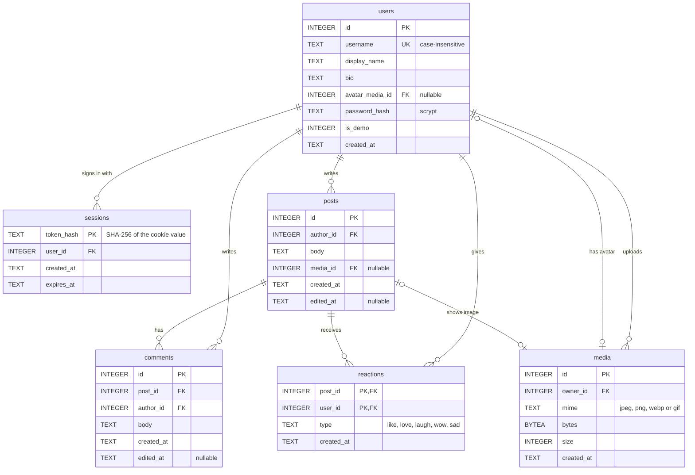

# Database and schema notes

Zocial stores everything in PostgreSQL: a free Supabase database in production, and PGlite (Postgres compiled to WebAssembly) on your computer and in the tests, so both run the same SQL. Uploaded images live in the database as `BYTEA`. That keeps backups to one database and means there are no upload folders whose paths could be abused. The schema is in [`server/db.ts`](../server/db.ts) and is created on start-up with `CREATE TABLE IF NOT EXISTS`.

## Entity relationship diagram



## Tables

### users

| Column | Type | Rules |
| --- | --- | --- |
| `id` | INTEGER | Primary key |
| `username` | TEXT | Unique. The app lowercases it before saving, so `Nour` and `nour` can't both exist, and allows only `a-z`, `0-9` and `_`, 3 to 20 characters. |
| `display_name` | TEXT | 2 to 40 characters |
| `bio` | TEXT | Up to 160 characters, empty by default |
| `avatar_media_id` | INTEGER | Points to `media.id`. `ON DELETE SET NULL`, so a missing photo falls back to initials. |
| `password_hash` | TEXT | `scrypt$salt$hash`. Seeded demo accounts store `!`, which no password can match. |
| `is_demo` | INTEGER | 1 for seeded accounts that can be entered from the sign-in page |
| `created_at` | TEXT | ISO 8601 UTC timestamp |

### sessions

One row per signed-in browser. The cookie holds a random 32-byte token. Only its SHA-256 hash is stored, so a copy of the database can't be used to take over sessions. Rows are deleted on sign-out and cascade away if the user is deleted.

### media

Every uploaded image, for posts and avatars. `mime` comes from the file's first bytes (its "magic number"), never from the browser, and the CHECK constraint limits it to four raster formats. SVG is refused because it can carry scripts. The browser shrinks photos to 1600 px (400 px for avatars) and re-encodes them as WebP before upload. The server caps a file at 3 MB.

Images are served by `GET /api/media/:id` with their stored type and `X-Content-Type-Options: nosniff`.

### posts

| Column | Notes |
| --- | --- |
| `author_id` | `ON DELETE CASCADE`: deleting a user deletes their posts |
| `body` | 0 to 1000 characters. The API refuses a post that has neither text nor an image. |
| `media_id` | Optional image. When the post is deleted, or the image is removed while editing, the API deletes the media row in the same transaction. |
| `edited_at` | Set on every edit and shown as "edited" in the UI |

### comments

Belong to a post (`ON DELETE CASCADE`) and an author (`ON DELETE CASCADE`). 1 to 500 characters.

### reactions

The primary key is `(post_id, user_id)`, which is what enforces **one reaction per person per post** at the database level. Changing your reaction is an upsert:

```sql
INSERT INTO reactions (post_id, user_id, type, created_at) VALUES (?, ?, ?, ?)
ON CONFLICT (post_id, user_id) DO UPDATE SET type = excluded.type;
```

## Delete rules at a glance

| When this is deleted | What happens |
| --- | --- |
| A user | Their sessions, posts, comments, reactions and media are deleted (CASCADE) |
| A post | Its comments and reactions are deleted (CASCADE). Its image is deleted by the API in the same transaction. |
| A comment | Nothing else |
| A media row | Any post or avatar pointing to it gets NULL (SET NULL) |

`users.avatar_media_id` and `media.owner_id` point at each other, so the avatar foreign key is added in a separate step after both tables exist. Schema creation and seeding run inside a transaction holding a Postgres advisory lock, so two serverless instances starting at the same moment can't create tables or seed twice.

## Indexes and the queries they serve

| Index | Used by |
| --- | --- |
| `idx_posts_feed (created_at DESC, id DESC)` | The main feed, newest first |
| `idx_posts_author (author_id, created_at DESC, id DESC)` | A profile's posts |
| `idx_comments_post (post_id, created_at, id)` | Comments under a post, oldest first |
| `idx_reactions_user (user_id)` | Finding "my reaction" on each post |
| `idx_sessions_user`, `idx_media_owner` | Cleaning up a user's rows |

## Pagination

Lists use **cursor pagination** rather than page numbers. The cursor is the `(created_at, id)` of the last item the client has, encoded as base64url so the client treats it as an opaque string.

```sql
-- next page of the feed
SELECT ... FROM posts p
WHERE (p.created_at, p.id) < (:cursor_created_at, :cursor_id)
ORDER BY p.created_at DESC, p.id DESC
LIMIT :limit + 1;
```

Fetching one extra row tells the server whether there is another page without a separate `COUNT(*)`. Including `id` in the comparison keeps the order stable when two posts share a timestamp.

Why not `LIMIT/OFFSET`? On a feed, new posts arrive at the top. With offsets, a new post pushes everything down one place, and the next page repeats the last post the user saw. With a cursor, page two always starts after the last post on page one. There is a test for exactly this case (`does not shift pages when a new post arrives`).

Comments use the same idea in ascending order (`>`), so a conversation reads top to bottom and "Show more comments" continues where it stopped.

## Authorization rules

The database stores who owns each row. The rules that use that ownership live in [`shared/rules.ts`](../shared/rules.ts) and are checked by the API before every change:

| Action | Allowed for |
| --- | --- |
| Edit or delete a post | `posts.author_id` = the signed-in user |
| Edit a comment | `comments.author_id` = the signed-in user |
| Delete a comment | the comment's author, or the author of the post it is on |
| Edit a profile or avatar | only through `/api/me`, which always acts on the signed-in user |

Each post and comment in an API response carries `canEdit` and `canDelete` flags computed for the person asking, so the UI shows the edit and delete controls only where they will work.

## Seed data

`server/seed.ts` creates eight fictional members, 38 posts spread over about three weeks, comments and reactions. Seven posts have landscape pictures. These are drawn as PNG files by [`server/placeholder-images.ts`](../server/placeholder-images.ts) with no image library, so the demo has real images without shipping binary files. A fixed random seed makes the data the same on every run. `npm run seed` resets a local database to this state.
